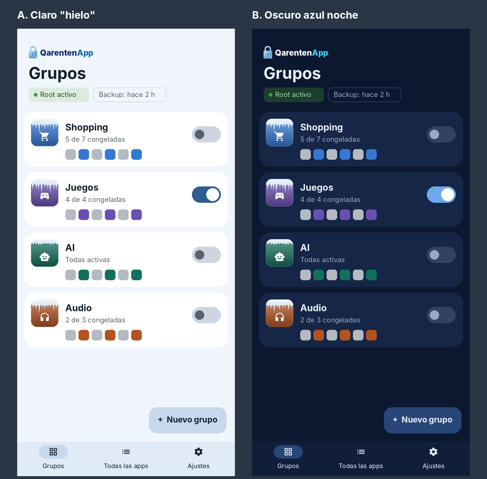
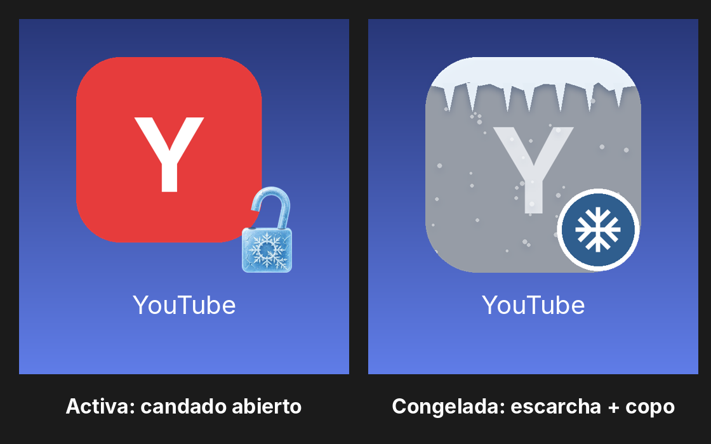
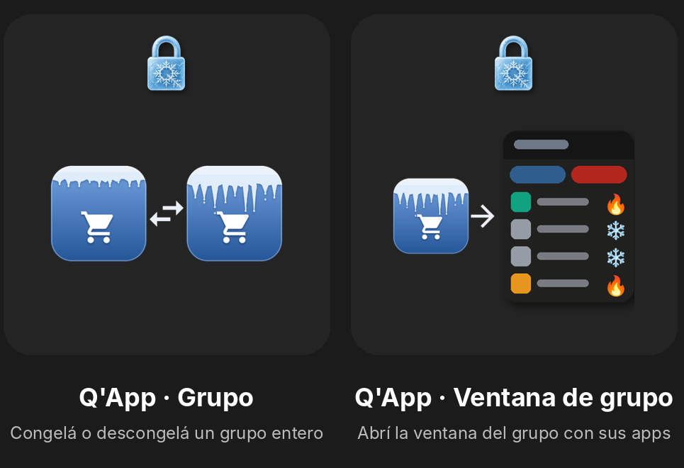
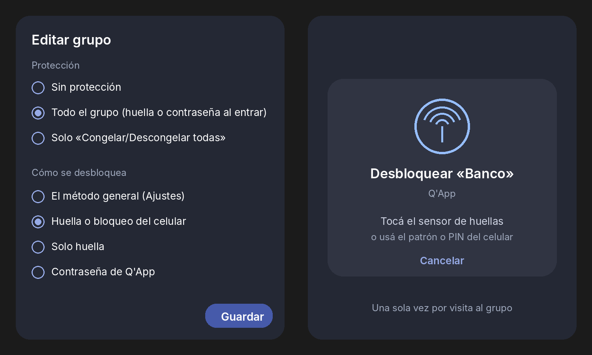
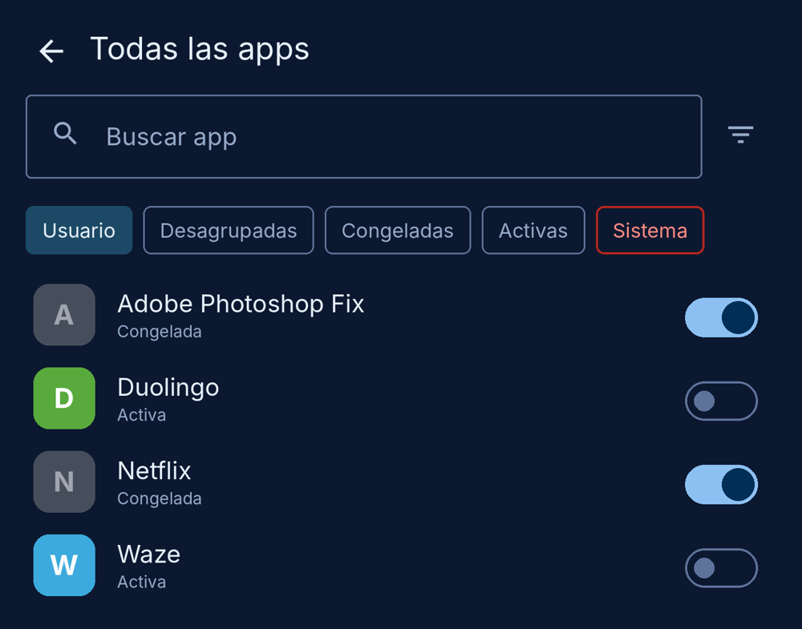

# QarentenApp (Q'App)

**Congelá las apps que no usás y activalas cuando las necesitás: por grupos, con widgets, accesos directos, notificación y protección con huella.**

Inspirada en la antigua y descontinuada aplicación llamada App Quarantine Pro. Funciona con **root** o con **[Shizuku](https://shizuku.rikka.app/)** (sin root).

> Creado por **@Sr.BernS - Bernardo Soage - Corrientes Argentina**

## ⬇️ Descargar

Último APK, siempre actualizado:

**[QarentenApp.apk](https://github.com/bersoage/QarentenApp/releases/latest/download/QarentenApp.apk)**

Cada versión también queda con su número en [Releases](https://github.com/bersoage/QarentenApp/releases) (`QarentenApp-beta-N.apk`).

## 🆕 Novedades

### 🧊 Grupos con carámbanos
Cada grupo tiene nombre, ícono (más de 100 para elegir) y color. El ícono se ve con carámbanos de hielo cuando el grupo está congelado. Mostrá y ocultá un grupo entero con un solo interruptor, o app por app. También podés **auto-agrupar** tus apps, sin internet, con confirmación.

### 🪟 Ventana flotante del grupo
Tocá el acceso directo o el widget de un grupo y se abre una ventana con **❄️ Congelar todas** y **🔥 Descongelar todas**, y cada app con su estado. Sin entrar a la app.

### 🧩 Tres widgets, y se distinguen
Se adaptan a cualquier launcher, también a los de 6 columnas.
- **Q'App · App:** congela o descongela una app. Activa se ve con el **candado abierto**; congelada, en gris con **escarcha** y un copo ❄️. Así no se confunde con el lanzador de la app.
- **Q'App · Grupo:** congela o descongela el grupo entero de un toque.
- **Q'App · Ventana de grupo:** abre la ventana flotante.

### 🔒 Protección por grupo, con huella o el bloqueo del celular
Elegís qué grupos quedan protegidos y cómo se desbloquean:
- **Todo el grupo:** huella o bloqueo del celular (patrón, PIN) **una sola vez al entrar**. Adentro no vuelve a pedirse.
- **Solo «todas»:** entrás libre y se pide autenticación en Congelar/Descongelar todas y en los toques de un paso.
- Métodos: huella o bloqueo del celular, solo huella, o contraseña propia de Q'App. Cada grupo puede usar el suyo.
- Rige también en widgets, accesos directos, ventana flotante y notificación. Los grupos libres quedan libres.
- Opcional: bloquear la entrada a Q'App.

### 🔎 Filtros que se combinan y búsqueda por grupo
Usuario, Desagrupadas, Congeladas, Activas y Sistema (en rojo, con advertencia). Se prenden y apagan solos y se combinan. Cada app muestra sus grupos (`Congelada · Grupos: Shopping, Redes`) y el buscador encuentra por nombre de app **y por nombre de grupo**.

### 🎨 Y también
- Fondos claro, azul noche, gris, negro OLED o automático, con 8 colores de acento.
- Notificación de apps activas con **❄️ Congelar** y **🔥 Descongelar**, en grilla o lista.
- Volver a congelar al reiniciar las apps que descongelaste en la sesión.
- Backup y restauración de tu configuración, para después de un formateo.

## Lo que conserva de App Quarantine Pro

**Congelar**
- Con root o Shizuku (detección automática, o elegido a mano).
- Apps de usuario, del sistema y servicios del sistema (con advertencias). Las esenciales están protegidas.
- Reiniciar el launcher después de congelar (opcional).

**Apps**
- Lista con búsqueda y filtros por estado.
- Filtro por permisos: internet, ubicación, mensajes, llamadas, servicios pagos, cuentas, etc.
- Ficha de cada app: versión, instalación, última actualización, partición, grupos y permisos.
- Favoritas.

**Accesos rápidos**
- Widgets de grupo o de app, con lanzamiento directo, fondo negro, ocultar nombre y ocultar estado.
- Accesos directos para abrir una app congelada (se descongela sola).
- Cajón de cuarentena (ventana o pantalla completa) y menú rápido.
- Mosaicos del panel rápido y accesos al mantener presionado el ícono.

**Notificación y mantenimiento**
- Notificación de apps activas: estilo automático, grilla (12) o lista (3). Permanente, un toque, solo activas.
- Vigilar actualizaciones: avisa (o vuelve a congelar sola) si una app en cuarentena se activó.
- Restaurar la cuarentena después de un reseteo.
- Backup: exportar / importar, carpeta automática y backup de Android. Apps pendientes con opción de quitarlas.
- Temas de íconos y reporte de error.

*Las imágenes son ilustraciones del diseño.*

## Instalación

1. Bajá el APK con el link de arriba, **desde Chrome** (el navegador integrado de algunas apps no instala APK).
2. Instalalo y abrilo. Elegí **root** o **Shizuku**; con Shizuku, activá primero las Opciones de desarrollador y el servicio.
3. Al abrir por primera vez, Q'App te ofrece armar los grupos automáticamente (opcional).

> Aviso: en modo Shizuku hay que tener activadas las Opciones de desarrollador. Algunas apps bancarias se niegan a abrir con eso encendido.

## Estado

Versión beta, en desarrollo. Si algo no anda, abrí un *issue* contando el modelo del dispositivo y la versión de Android.

## Créditos

- Desarrollo y diseño: **@Sr.BernS - Bernardo Soage - Corrientes Argentina**
- Inspirada en la antigua y descontinuada aplicación llamada App Quarantine Pro.
- [Shizuku](https://shizuku.rikka.app/) para el modo sin root.
